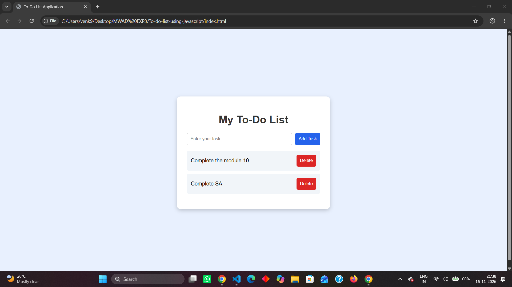

# Ex03 To-Do List using JavaScript
## Date: 17-11-2026
## Name: Venkatesh.P
## Reg No: 212225230295

## AIM
To create a To-do Application with all features using JavaScript.

## ALGORITHM
### STEP 1
Build the HTML structure (index.html).

### STEP 2
Style the App (style.css).

### STEP 3
Plan the features the To-Do App should have.

### STEP 4
Create a To-do application using Javascript.

### STEP 5
Add functionalities.

### STEP 6
Test the App.

### STEP 7
Open the HTML file in a browser to check layout and functionality.

### STEP 8
Fix styling issues and refine content placement.

### STEP 9
Deploy the website.

### STEP 10
Upload to GitHub Pages for free hosting.

## PROGRAM
HTML
```
<!DOCTYPE html>
<html>
<head>
    <title>To-Do List Application</title>
    <link rel="stylesheet" href="style.css">
</head>
<body>

    <div class="container">
        <h1>My To-Do List</h1>

        <div class="input-section">
            <input type="text" id="taskInput"
                   placeholder="Enter your task">

            <button onclick="addTask()">Add Task</button>
        </div>

        <ul id="taskList"></ul>
    </div>

    <script src="script.js"></script>
</body>
</html>
```
CSS
```
body {
    font-family: Arial, sans-serif;
    background: #e8f0fe;
    display: flex;
    justify-content: center;
    align-items: center;
    min-height: 100vh;
}

.container {
    background: white;
    padding: 30px;
    width: 400px;
    border-radius: 12px;
    box-shadow: 0 4px 12px rgba(0,0,0,0.2);
}

h1 {
    text-align: center;
    color: #333;
}

.input-section {
    display: flex;
    gap: 10px;
}

input {
    flex: 1;
    padding: 10px;
    border: 1px solid #ccc;
    border-radius: 5px;
}

button {
    padding: 10px;
    background: #2563eb;
    color: white;
    border: none;
    border-radius: 5px;
    cursor: pointer;
}

button:hover {
    background: #1d4ed8;
}

ul {
    padding: 0;
    list-style: none;
}

li {
    background: #f1f5f9;
    padding: 12px;
    margin-top: 10px;
    display: flex;
    justify-content: space-between;
    align-items: center;
    border-radius: 5px;
}

.completed {
    text-decoration: line-through;
    color: gray;
}

.delete {
    background: #dc2626;
}
```
JS
```

function addTask() {
    let input = document.getElementById("taskInput");
    let task = input.value.trim();

    if (task === "") {
        alert("Please enter a task!");
        return;
    }

    let li = document.createElement("li");

    let span = document.createElement("span");
    span.textContent = task;

    // Mark task as completed
    span.onclick = function() {
        span.classList.toggle("completed");
    };

    // Delete button
    let deleteBtn = document.createElement("button");
    deleteBtn.textContent = "Delete";
    deleteBtn.className = "delete";

    deleteBtn.onclick = function() {
        li.remove();
    };

    li.appendChild(span);
    li.appendChild(deleteBtn);

    document.getElementById("taskList").appendChild(li);

    input.value = "";
}
```
## OUTPUT


## RESULT
The program for creating To-do list using JavaScript is executed successfully.
